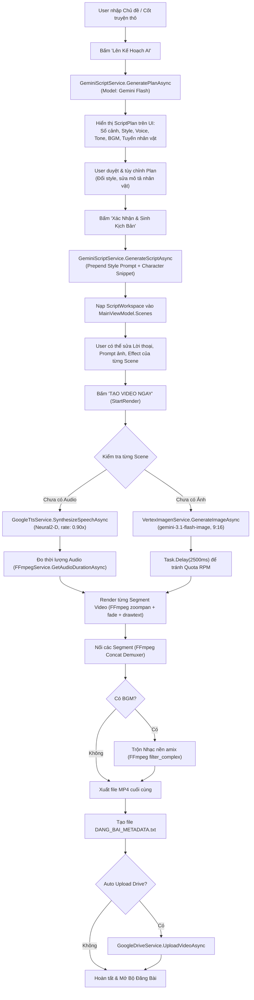
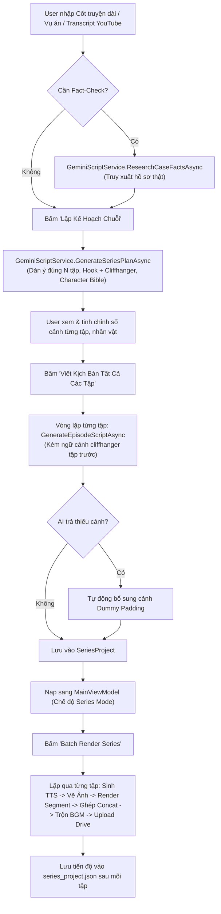

# TÀI LIỆU KỸ THUẬT & HỆ THỐNG GENERATE VIDEO AI (DÀNH CHO AI CODE REVIEW)
> **Tên tài liệu:** `README_AI_REVIEW.md`  
> **Dự án:** [VideoAutoWpf](file:///c:/TOOL/VideoAutoWpf)  
> **Mục đích:** Tài liệu kỹ thuật chi tiết 100% bám sát source code thực tế. Không phục vụ mục đích quảng bá (marketing). Tài liệu được cấu trúc chuyên biệt để các hệ thống AI phân tích, đánh giá kiến trúc, phát hiện lỗi ngầm và đề xuất cải tiến toàn diện cho pipeline tạo video AI tự động.  
> **Nguyên tắc biên soạn:** Trung thực tuyệt đối, không suy đoán tính năng chưa có, trích dẫn file/symbol cụ thể, ghi rõ `UNKNOWN` hoặc `CHƯA XÁC ĐỊNH` với các thành phần không thể xác minh từ mã nguồn.

---

# 1. Project Overview

* **Tên project:** `VideoAutoWpf` (Namespace chính: `VideoAutoWpf`).
* **Mục đích phần mềm:** Ứng dụng Desktop chạy trên Windows dành cho việc sản xuất video tự động hàng loạt từ kịch bản văn bản hoặc chủ đề (vụ án, tâm lý, bí ẩn, tài liệu, kiến thức...). Hỗ trợ hai định dạng trọng tâm: Video ngắn dọc (`9:16` cho TikTok, YouTube Shorts, Facebook Reels) và Video ngang dài/nhiều tập (`16:9` cho YouTube Video / Series).
* **Phần mềm hiện tại có thể làm được những gì (Thực tế trong code):**
  1. **Lên kế hoạch video đơn lẻ (AI Planning):** Phân tích chủ đề người dùng nhập, đề xuất số lượng cảnh (scenes), phong cách hình ảnh (style), tone giọng, giọng đọc Cloud TTS, hiệu ứng chuyển động camera (Ken Burns), nhạc nền (BGM), kiểu phụ đề và bóc tách tuyến nhân vật ban đầu ([GeminiScriptService.GeneratePlanAsync](file:///c:/TOOL/VideoAutoWpf/Services/GeminiScriptService.cs#L99)).
  2. **Viết kịch bản chi tiết:** Sinh JSON cấu trúc gồm danh sách các phân cảnh: Lời thoại tiếng Việt (narration), mô tả ảnh tiếng Anh (image prompt), camera motion effect, nhân vật xuất hiện ([GeminiScriptService.GenerateScriptAsync](file:///c:/TOOL/VideoAutoWpf/Services/GeminiScriptService.cs#L176)).
  3. **Lập kế hoạch & Viết kịch bản Series nhiều tập (Multi-Episode Series):** Phân chia một chủ đề/cốt truyện dài thành $N$ tập phim có đánh số thứ tự tuần tự ($1 \to N$), tạo hook mở màn và cliffhanger kết thúc cho từng tập, thiết lập Character Bible đồng bộ toàn series ([GeminiScriptService.GenerateSeriesPlanAsync](file:///c:/TOOL/VideoAutoWpf/Services/GeminiScriptService.cs#L315), [GenerateEpisodeScriptAsync](file:///c:/TOOL/VideoAutoWpf/Services/GeminiScriptService.cs#L383)).
  4. **Tra cứu hồ sơ vụ án thực tế (AI Fact-Checking):** Truy vấn tư liệu thật để kịch bản không bịa đặt cốt truyện giả tưởng đối với các đề tài án mạng/lịch sử ([GeminiScriptService.ResearchCaseFactsAsync](file:///c:/TOOL/VideoAutoWpf/Services/GeminiScriptService.cs#L749)).
  5. **Cào dữ liệu & Bóc tách kênh YouTube đối thủ:** Kết nối YouTube Data API v3 để lấy video thịnh hành, bóc tách công thức tiêu đề (Title Formula), kỹ thuật giữ chân (Retention Hook), tâm lý người xem và nạp trực tiếp sang bộ tạo kịch bản ([YouTubeAnalyticsService.cs](file:///c:/TOOL/VideoAutoWpf/Services/YouTubeAnalyticsService.cs), [CompetitorPatternAnalyzer.cs](file:///c:/TOOL/VideoAutoWpf/Services/CompetitorPatternAnalyzer.cs)).
  6. **Tự động tải transcript video YouTube:** Lấy phụ đề gốc của video YouTube làm dữ liệu đầu vào cho series ([YouTubeAnalyticsService.GetVideoTranscriptAsync](file:///c:/TOOL/VideoAutoWpf/Services/YouTubeAnalyticsService.cs)).
  7. **Sinh giọng đọc AI chất lượng cao (Google Cloud TTS):** Sử dụng các voice Neural2 và WaveNet tiếng Việt (`vi-VN-Neural2-D`, `vi-VN-Neural2-A`), điều chỉnh tốc độ nói (speaking rate mặc định 0.90x), lưu file MP3 ([GoogleTtsService.cs](file:///c:/TOOL/VideoAutoWpf/Services/GoogleTtsService.cs)).
  8. **Sinh hình ảnh AI:** Gọi Google Cloud Vertex AI endpoint của model `gemini-3.1-flash-image` (fallback sang `gemini-2.5-flash-image`) với `responseModalities: ["IMAGE"]`, xuất file PNG tỷ lệ `9:16` hoặc `16:9` ([VertexImagenService.cs](file:///c:/TOOL/VideoAutoWpf/Services/VertexImagenService.cs)).
  9. **Dựng video tự động bằng FFmpeg:** Render từng phân cảnh bằng filter `zoompan` (Ken Burns effect), hiệu ứng `vignette`, chuyển cảnh `fade`, lớp phủ phụ đề `drawtext`, ghép nối các phân cảnh qua Concat Demuxer, trộn nhạc nền `amix` ([FFmpegService.cs](file:///c:/TOOL/VideoAutoWpf/Services/FFmpegService.cs)).
  10. **Tự động sinh bộ Metadata đăng bài:** Xuất file [DANG_BAI_METADATA.txt](file:///c:/TOOL/VideoAutoWpf/Services/FFmpegService.cs#L378) chứa Tiêu đề giật gân, Tiêu đề thay thế, Mô tả video, Hashtags và toàn bộ lời thoại kịch bản.
  11. **Tự động tải lên Google Drive:** Upload video thành phẩm lên Google Drive qua Service Account, hỗ trợ tạo thư mục series và trả về link xem trực tiếp ([GoogleDriveService.cs](file:///c:/TOOL/VideoAutoWpf/Services/GoogleDriveService.cs)).
  12. **Batch Render Series:** Cho phép dựng tự động liên tục toàn bộ các tập của một Series, lưu tiến độ vào file `series_project.json` ([MainViewModel.StartBatchRenderSeriesAsync](file:///c:/TOOL/VideoAutoWpf/ViewModels/MainViewModel.cs#L1564)).
* **Những gì CHƯA LÀM ĐƯỢC hoặc còn hạn chế nghiêm trọng:**
  1. **Không phải Video Diffusion thực thụ:** Video thực chất là chuỗi các ảnh tĩnh 2D ghép lại và áp dụng hiệu ứng chuyển động giả lập (Ken Burns pan/zoom 2.5D bằng FFmpeg). Nhân vật trong video không cử động môi (lip-sync), không cử động tay chân hay biểu cảm động.
  2. **Không có cơ chế Image Conditioning (IP-Adapter / LoRA / ControlNet):** Vertex AI Gemini Image API hiện chỉ nhận text prompt thuần túy. Việc giữ độ nhất quán của nhân vật (character consistency) hoàn toàn phụ thuộc vào việc ghép chuỗi văn bản mô tả ngoại hình vào prompt, dẫn đến việc cùng một nhân vật nhưng giữa các cảnh có thể thay đổi khuôn mặt và chi tiết trang phục.
  3. **Lỗi cú pháp FFmpeg ở tính năng phụ đề Karaoke:** Code xây dựng chuỗi drawtext cho Karaoke sử dụng hàm không hợp lệ `tw('filepath')` khiến FFmpeg báo lỗi filter và phải fallback về video không có phụ đề ([FFmpegService.cs#L726](file:///c:/TOOL/VideoAutoWpf/Services/FFmpegService.cs#L726)).
  4. **Cơ chế xử lý khi hết hạn mức ảnh (Quota Fallback):** Nếu Vertex AI gặp lỗi 429 sau các lần retry, hệ thống tự động copy ảnh của phân cảnh trước đó làm ảnh phân cảnh hiện tại để video không bị dừng ([MainViewModel.cs#L1368](file:///c:/TOOL/VideoAutoWpf/ViewModels/MainViewModel.cs#L1368)). Điều này dẫn đến tình trạng hai phân cảnh liên tiếp có nội dung lời thoại khác nhau nhưng hiển thị cùng một hình ảnh.
  5. **Bổ sung cảnh giả (Dummy Padding) trong Series:** Nếu AI trả về ít cảnh hơn số lượng cấu hình, code tự động sinh các cảnh rỗng với lời thoại chung chung và tái sử dụng prompt ảnh trước đó ([SeriesCreatorViewModel.cs#L729](file:///c:/TOOL/VideoAutoWpf/ViewModels/SeriesCreatorViewModel.cs#L729)).

---

# 2. Technology Stack

* **.NET Runtime / SDK:** `.NET 10.0` (Target Framework: `net10.0-windows` được chỉ định trong [VideoAutoWpf.csproj](file:///c:/TOOL/VideoAutoWpf/VideoAutoWpf.csproj#L4)).
* **WPF Framework:** Native Windows Presentation Foundation (WPF) trên .NET 10. Kiến trúc MVVM chuẩn sử dụng Source Generators.
* **Ngôn ngữ C#:** C# 13 (`<Nullable>enable</Nullable>`, `<ImplicitUsings>enable</ImplicitUsings>`).
* **NuGet Packages chính thức (khai báo trong [VideoAutoWpf.csproj](file:///c:/TOOL/VideoAutoWpf/VideoAutoWpf.csproj)):**
  * `CommunityToolkit.Mvvm` (v8.4.2): Quản lý ViewModel, `ObservableObject`, `[ObservableProperty]`, `[RelayCommand]`.
  * `Google.Cloud.TextToSpeech.V1` (v3.7.0): SDK chính thức gọi Google Cloud Text-to-Speech API.
  * `Google.Cloud.Speech.V2` (v1.3.0): SDK chính thức gọi Google Cloud Speech-to-Text V2 (Model Chirp 2).
  * `Google.Apis.YouTube.v3` (v1.69.0.3631): SDK gọi YouTube Data API v3.
  * `Google.Apis.Drive.v3` (v1.69.0.3629): SDK gọi Google Drive API v3.
  * `Google.Apis.Auth` (v1.69.0): Xác thực Google Service Account & OAuth2.
  * `System.Text.Json`: Thư viện xử lý JSON tích hợp sẵn của .NET.
* **External APIs & Cloud Services:**
  1. **Google Cloud Text-to-Speech API:** Endpoint RPC/REST cho tổng hợp giọng đọc tiếng Việt Neural2 & WaveNet.
  2. **Google Cloud Speech-to-Text API v2:** Nhận diện mốc thời gian từng từ (`word_level_timestamps`) bằng model `chirp_2`.
  3. **Google Cloud Vertex AI (AI Platform):** Endpoint REST `https://aiplatform.googleapis.com/v1/projects/{projectId}/locations/global/publishers/google/models/{model}:generateContent` để tạo ảnh (Models: `gemini-3.1-flash-image`, `gemini-2.5-flash-image`).
  4. **Google AI Studio (Gemini Developer API):** Endpoint REST `https://generativelanguage.googleapis.com/v1beta/models/{model}:generateContent?key={apiKey}` để sinh kịch bản, lập dàn ý, fact-check (Models: `gemini-3.5-flash-lite`, `gemini-flash-lite-latest`, `gemini-3.1-flash-lite`, `gemini-3.8-flash`, v.v.).
  5. **YouTube Data API v3:** Truy vấn thông tin kênh, danh sách video, thống kê view/like, thẻ tags.
  6. **Google Drive API v3:** Tải video thành phẩm lên Google Drive, quản lý quyền chia sẻ thư mục.
* **FFmpeg / Thư viện xử lý Video & Audio:**
  * Gọi trực tiếp tiến trình ngoài `ffmpeg.exe` qua `System.Diagnostics.Process`.
  * Đường dẫn tìm kiếm tự động: `customPath` do người dùng cấu hình $\to$ Biến môi trường hệ thống `PATH` $\to$ Thư mục cục bộ `ffmpeg/ffmpeg.exe` $\to$ Cây thư mục runtime của ứng dụng ([FFmpegService.LocateFfmpeg](file:///c:/TOOL/VideoAutoWpf/Services/FFmpegService.cs#L32)).
  * Audio Preview trên giao diện: Sử dụng class `System.Windows.Media.MediaPlayer` của WPF.
* **Database:** Không sử dụng cơ sở dữ liệu quan hệ hay NoSQL. Dữ liệu được lưu trữ dạng file phẳng (`.json`, `.txt`, `.mp4`, `.mp3`, `.png`).
* **File Storage:**
  * Thư mục cấu hình: `Config/` (chứa `google_credentials.json`, `gemini_api_key.txt`, `drive_config.txt`).
  * Thư mục tài nguyên: `Assets/Bgm/` (chứa các file nhạc nền MP3).
  * Thư mục xuất video: Mặc định tại `Environment.SpecialFolder.MyVideos/VideoAutoOutput` hoặc đường dẫn tùy chọn do người dùng đặt. Mỗi video xuất ra được tổ chức thành thư mục riêng gồm: `Images/`, `Audio/`, `Video/`, `DANG_BAI_METADATA.txt`.

---

# 3. Project Structure

Dưới đây là sơ đồ cấu trúc thư mục thực tế của dự án:

```
c:\TOOL\VideoAutoWpf\
├── VideoAutoWpf.csproj           # Project file (.NET 10-windows, dependencies)
├── App.xaml / App.xaml.cs        # Entry point của ứng dụng WPF
├── MainWindow.xaml / .cs         # Màn hình chính điều khiển và render video
├── Config/                       # Thư mục lưu credentials và API keys
│   ├── google_credentials.json   # Google Cloud Service Account JSON key
│   ├── gemini_api_key.txt        # Google AI Studio API key (tự do lưu trữ)
│   └── drive_config.txt          # Google Drive Folder ID cấu hình
├── Assets/
│   └── Bgm/                      # Thư mục chứa các file nhạc nền MP3
├── Components/                   # Các UserControl tái sử dụng trên giao diện
│   ├── VideoConfigControl.xaml   # Cấu hình tỷ lệ, giọng đọc, hiệu ứng, thư mục xuất
│   ├── SceneListControl.xaml     # Danh sách cuộn chứa các phân cảnh
│   └── SceneCardControl.xaml     # Thẻ hiển thị/chỉnh sửa chi tiết từng phân cảnh
├── Views/                        # Các cửa sổ chức năng độc lập (Modal Windows)
│   ├── ScriptGeneratorWindow.xaml/.cs # Cửa sổ tạo kịch bản video đơn lẻ (2 bước)
│   ├── SeriesCreatorWindow.xaml/.cs   # Cửa sổ tạo kịch bản chuỗi nhiều tập (Series)
│   ├── YouTubeAnalyticsWindow.xaml/.cs# Cửa sổ phân tích kênh/video đối thủ YouTube
│   └── SocialPublishWindow.xaml/.cs   # Cửa sổ xem và sao chép metadata đăng mạng xã hội
├── ViewModels/                   # Logic MVVM, xử lý commands và binding dữ liệu
│   ├── MainViewModel.cs          # Quản lý pipeline render, scenes, BGM, Drive upload
│   ├── ScriptGeneratorViewModel.cs# Quản lý luồng AI planning & tạo kịch bản đơn lẻ
│   ├── SeriesCreatorViewModel.cs # Quản lý luồng series planning, fact-check, tạo tập
│   └── YouTubeAnalyticsViewModel.cs# Quản lý truy vấn kênh đối thủ, bóc tách công thức
├── Services/                     # Lớp hạ tầng và tương tác dịch vụ bên ngoài
│   ├── GoogleAuthService.cs      # Xác thực Google Cloud Service Account & lấy token
│   ├── GeminiScriptService.cs    # Tương tác Gemini AI (kịch bản, dàn ý, fact-check)
│   ├── VertexImagenService.cs    # Gọi Vertex AI Gemini Image sinh hình ảnh
│   ├── GoogleTtsService.cs       # Gọi Google Cloud TTS sinh audio thuyết minh
│   ├── GoogleSttService.cs       # Gọi Google Cloud Speech V2 nhận diện word timestamps
│   ├── FFmpegService.cs          # Thực thi FFmpeg render segments, concat, trộn BGM
│   ├── BgmService.cs             # Sinh nhạc nền tổng hợp bằng FFmpeg lavfi & quét MP3
│   ├── GoogleDriveService.cs     # Upload video và quản lý thư mục Google Drive
│   ├── YouTubeAnalyticsService.cs# Tương tác YouTube Data API v3 & lấy transcript
│   └── CompetitorPatternAnalyzer.cs# Thuật toán heuristic bóc tách tiêu đề/hook đối thủ
└── Models/                       # Các thực thể dữ liệu (Data models & DTOs)
    ├── CharacterProfile.cs       # Hồ sơ nhân vật (Id, Name, Appearance, VisualPrompt)
    ├── SceneItem.cs              # Dữ liệu phân cảnh hiển thị trên UI & render
    ├── ScriptPlan.cs             # Kế hoạch video đơn lẻ do AI đề xuất
    ├── ScriptWorkspace.cs        # Kịch bản chi tiết hoàn chỉnh trả về từ AI
    ├── SeriesPlan.cs             # Kế hoạch dàn ý chuỗi nhiều tập
    ├── SeriesProject.cs          # Dữ liệu lưu trữ dự án Series (.series.json)
    ├── EpisodeItem.cs            # Một tập trong series kèm danh sách scenes
    ├── VideoConfig.cs            # Cấu hình thông số render video cho FFmpeg
    ├── VideoPublishInfo.cs       # Metadata đăng bài (Tiêu đề, Mô tả, Hashtags)
    ├── TopicCard.cs              # Preset thể loại, style, voice, tone, font, motion
    └── YouTubeAnalyticsModels.cs # DTO cho dữ liệu phân tích kênh và video YouTube
```

---

# 4. Application Flow

Hệ thống có hai luồng tạo video chính: **Chế độ Video Đơn Lẻ (Single Video)** và **Chế độ Chuỗi Nhiều Tập (Multi-Episode Series)**.

## 4.1. Luồng Video Đơn Lẻ (Single Video Flow)



## 4.2. Luồng Chuỗi Nhiều Tập (Multi-Episode Series Flow)



---

# 5. AI Generation Pipeline

## 5.1. Script Generation

* **API & Model sử dụng:**
  * Phương thức: [GeminiScriptService.CallGeminiForJson<T>](file:///c:/TOOL/VideoAutoWpf/Services/GeminiScriptService.cs#L604).
  * Danh sách Model dự phòng lần lượt (fallback array):
    * Khi dùng API Key (Google AI Studio): `gemini-3.5-flash-lite`, `gemini-flash-lite-latest`, `gemini-3.1-flash-lite`, `gemini-3.8-flash`, `gemini-3.6-flash`, `gemini-3.7-flash`, `gemini-3.5-flash`.
    * Khi dùng Service Account (Vertex AI): `gemini-3.5-flash-lite`, `gemini-3.1-flash-lite`, `gemini-3.8-flash`, `gemini-3.6-flash`, `gemini-3.5-flash`.
* **Input đầu vào:** Chuỗi chủ đề `topic`, thông tin kế hoạch `ScriptPlan`, quy tắc nhân vật `characterRules`.
* **Output format & Schema:** Bắt buộc trả về raw JSON (đã cấu hình `responseMimeType = "application/json"`, `temperature = 0.7`, `maxOutputTokens = 8192`). Schema ánh xạ trực tiếp vào class [ScriptWorkspace](file:///c:/TOOL/VideoAutoWpf/Models/ScriptWorkspace.cs):
  ```json
  {
    "metadata": {
      "ratio": "9:16",
      "voice": "vi-VN-Neural2-D",
      "enable_fade": true,
      "enable_vignette": false,
      "music": "dramatic",
      "enable_music": true,
      "music_volume": 0.15,
      "enable_subtitles": true,
      "subtitle_style": "cinematic",
      "subtitle_font": "Segoe UI Bold"
    },
    "publish_info": {
      "title": "Tiêu đề video...",
      "alternative_titles": "- Tiêu đề 2\n- Tiêu đề 3",
      "description": "Mô tả ngắn...",
      "hashtags": "#chude #xuhuong #shorts"
    },
    "scenes": [
      {
        "text": "Lời thoại tiếng Việt (18-35 từ)...",
        "characters_present": ["Tên nhân vật hoặc rỗng"],
        "image_prompt": "Mô tả ảnh tiếng Anh có style prefix...",
        "motion_effect": "zoom_in"
      }
    ]
  }
  ```
* **Validation & Retry:**
  * Có timeout 25 giây cho mỗi lượt gọi (`cts.CancelAfter(TimeSpan.FromSeconds(25))`).
  * Có logic làm sạch markdown wrapper: cắt bỏ ```` ```json ```` và ```` ``` ```` ở đầu và cuối chuỗi JSON.
  * Tự động thử lại với model tiếp theo trong danh sách nếu model hiện tại trả về mã lỗi HTTP hoặc quá 25s không phản hồi.

## 5.2. Scene Generation

* **Cách chia script thành scene:** Do Gemini tự phân bổ trong prompt. Prompt yêu cầu:
  * Mỗi phân cảnh phải là một nhịp kể chuyện hoàn chỉnh (narrative beat) có độ dài từ 18 đến 35 từ tiếng Việt (tương đương khoảng 8 đến 14 giây đọc).
  * Nghiêm cấm chia thành các câu quá ngắn (3-4 từ) gây hiện tượng đổi ảnh liên tục dồn dập.
* **Các trường dữ liệu trong Scene:**
  * `Text`: Nội dung thuyết minh tiếng Việt.
  * `ImagePrompt`: Câu prompt tiếng Anh gửi cho model vẽ ảnh.
  * `CharactersPresent`: Danh sách tên nhân vật có mặt trong khung hình (nếu rỗng thì là cảnh ngoại cảnh, hiện trường, vật chứng).
  * `MotionEffect`: Hiệu ứng chuyển động máy quay được chỉ định (`zoom_in`, `zoom_out`, `pan_left_right`, `pan_right_left`, `pan_up`, `pan_down`, `zoom_pan_right`, `zoom_pan_left`).
* **Cách xác định Duration:**
  * Ban đầu trên kịch bản, thời lượng chưa được xác định trước.
  * Duration được tính toán **hoàn toàn phụ thuộc vào file âm thanh TTS thực tế**. Sau khi TTS tạo ra file MP3, FFmpeg chạy lệnh phân tích và trích xuất thời lượng chính xác đến mili-giây qua Regex stderr. Video segment của scene đó sẽ được kéo dài đúng bằng độ dài của file âm thanh.

## 5.3. Image Prompt Generation

* **Nơi tạo prompt:** Tạo trực tiếp trong câu trả lời JSON của Gemini tại [GeminiScriptService.GenerateScriptAsync](file:///c:/TOOL/VideoAutoWpf/Services/GeminiScriptService.cs#L176) hoặc [GenerateEpisodeScriptAsync](file:///c:/TOOL/VideoAutoWpf/Services/GeminiScriptService.cs#L383).
* **Cơ chế ghép Prompt (Prompt Construction):**
  1. **Style Prefix:** Gemini được chỉ định bắt buộc chèn đoạn mô tả phong cách đã chọn vào đầu *mỗi câu prompt* (ví dụ: style `dark-anime` chèn đoạn: `"In a modern dark anime comic illustration style, high-end 2D graphic novel art, clean sharp line art, flat dramatic cel shading, intense cinematic moody lighting, deep shadows, high contrast, mature crime detective aesthetic, no childish cartoons, no random fantasy elements, portrait aspect ratio 9:16. "`).
  2. **Character Snippet:** Nếu `characters_present` có chứa nhân vật, Gemini được yêu cầu chèn đoạn mô tả tiếng Anh cố định của nhân vật đó từ Character Roster vào prompt.
  3. **Real-world Grounding Rule:** Yêu cầu nghiêm cấm vẽ các chi tiết kỳ ảo (phù thủy, cầu phát sáng, cổng torii) nếu bối cảnh là phóng sự tội phạm thực tế.
  4. **Environment/Clue Shots:** Nếu cảnh nói về bằng chứng, dấu vết, Gemini được yêu cầu để `characters_present: []` và chỉ tập trung vẽ đồ vật hoặc bối cảnh.
* **Đánh giá tính nhất quán (Consistency):**
  * **Style consistency:** Mức độ trung bình - khá (do có style prefix cố định cho mọi cảnh).
  * **Character consistency:** **Kém đến trung bình**. Hệ thống không truyền ảnh tham chiếu (Image Reference) hoặc Seed vào model tạo ảnh. Việc giữ khuôn mặt nhân vật phụ thuộc 100% vào năng lực hiểu văn bản của Gemini Image.
  * **Location consistency:** Kém. Không có cơ chế lưu trữ mô tả không gian cố định giữa các cảnh.

## 5.4. Image Generation

* **API & Model:** Google Cloud Vertex AI endpoint:
  * URL: `https://aiplatform.googleapis.com/v1/projects/{projectId}/locations/global/publishers/google/models/{modelName}:generateContent`
  * Model thử nghiệm ưu tiên: `gemini-3.1-flash-image`.
  * Model dự phòng (fallback): `gemini-2.5-flash-image`.
* **Cấu hình Payload:**
  ```json
  {
    "contents": [{ "role": "user", "parts": [{ "text": "{prompt}" }] }],
    "generationConfig": {
      "responseModalities": ["IMAGE"],
      "imageConfig": {
        "aspectRatio": "9:16" // hoặc "16:9", "1:1", "4:3", "3:4"
      }
    }
  }
  ```
* **Độ phân giải (Resolution):** Do Google backend quyết định dựa trên `aspectRatio` (thường là $1024 \times 1792$ cho `9:16` hoặc $1792 \times 1024$ cho `16:9`). Sau đó FFmpeg sẽ resize về kích thước chuẩn ($1080 \times 1920$ hoặc $1920 \times 1080$).
* **Số lượng ảnh:** 1 ảnh duy nhất cho mỗi phân cảnh.
* **Retry & Error Handling:**
  * **Sliding Window Rate Limiter:** Tích hợp bộ điều tiết tốc độ chủ động (tối đa 4 requests / 60 giây) trước khi gọi Vertex AI để không bao giờ bị vượt ngưỡng ~5 RPM của Google Cloud.
  * Thử tối đa 5 lần cho mỗi model.
  * Nếu gặp lỗi HTTP 429 (`TooManyRequests` hoặc `RESOURCE_EXHAUSTED`): Chờ backoff tăng dần (15s, 30s, 45s, 60s) để cửa sổ trượt 60s của Google Cloud được giải phóng hoàn toàn ([VertexImagenService.cs](file:///c:/TOOL/VideoAutoWpf/Services/VertexImagenService.cs)). Tiếp tục giữ model chính `gemini-3.1-flash-image` và KHÔNG chuyển sang model không tồn tại.
  * Nếu model trả về 404: Bỏ qua ngay và thử model tiếp theo (`gemini-2.5-flash-image`).
  * Nếu máy chủ lỗi 5xx: Chờ tăng dần (5s, 10s...) rồi thử lại.
  * **Cơ chế Pipeline V2:** Tuyệt đối KHÔNG copy ảnh cũ của cảnh trước nếu thất bại; báo lỗi rõ ràng và lưu trạng thái từng Shot (`Failed` / `Ready`) để người dùng có thể thử lại chính xác shot bị lỗi.
* **Lưu trữ file:** Trích xuất Base64 từ `inlineData.data`, ghi ra file PNG tại `OutputDirectory/generated_assets/shot_s{sNum}_{shotCode}_{HHmmss}.png`.

## 5.5. TTS (Text-to-Speech)

* **API & Model:** Google Cloud Text-to-Speech V1 SDK ([GoogleTtsService.cs](file:///c:/TOOL/VideoAutoWpf/Services/GoogleTtsService.cs)).
* **Danh sách Voice có sẵn:**
  * `vi-VN-Neural2-D`: Nam cao cấp (Mặc định - Trầm ấm, truyền cảm, tự nhiên).
  * `vi-VN-Neural2-A`: Nữ cao cấp (Truyền cảm, tự nhiên).
  * `vi-VN-Wavenet-B`: Nam (Trầm).
  * `vi-VN-Wavenet-A`: Nữ (Nhẹ nhàng).
  * `vi-VN-Wavenet-C`: Nữ (Sáng).
  * `vi-VN-Wavenet-D`: Nam (Năng động).
* **Ngôn ngữ:** `vi-VN`.
* **Tốc độ (Speaking Rate):** Mặc định là `0.90x` (người dùng có thể chọn từ `0.80x` đến `1.00x` trong [MainViewModel.cs#L37](file:///c:/TOOL/VideoAutoWpf/ViewModels/MainViewModel.cs#L37)).
* **Định dạng Audio:** `AudioEncoding.Mp3`.
* **Xác định thời lượng (Duration):** Gọi FFmpeg kiểm tra file qua lệnh `ffmpeg -i "audio.mp3"` và trích xuất bằng Regex:
  ```csharp
  var match = Regex.Match(stderr, @"Duration:\s*(\d+):(\d+):(\d+\.?\d*)");
  // return hours * 3600 + minutes * 60 + seconds;
  ```
  Nếu đọc thất bại, mặc định gán là `5.0` giây ([FFmpegService.cs#L181](file:///c:/TOOL/VideoAutoWpf/Services/FFmpegService.cs#L181)).

## 5.6. Video Composition (FFmpeg Rendering Engine)

Quá trình dựng video diễn ra theo 3 giai đoạn độc lập:

### Giai đoạn 1: Render từng Segment phân cảnh ([FFmpegService.RenderSegmentAsync](file:///c:/TOOL/VideoAutoWpf/Services/FFmpegService.cs#L420))
* **Cấu trúc lệnh thực thi:**
  ```bash
  ffmpeg -y -loop 1 -i "{imagePath}" -i "{audioPath}" -c:v libx264 -tune stillimage -r {fps} -vf "{filterString}" -c:a aac -b:a 192k -pix_fmt yuv420p -t {duration} "{outputPath}"
  ```
* **Giải thích các tham số:**
  * `-loop 1 -i "{imagePath}"`: Lặp lại bức ảnh tĩnh vô hạn lần để cấp nguồn hình ảnh cho video.
  * `-i "{audioPath}"`: Cung cấp nguồn âm thanh từ file TTS.
  * `-c:v libx264 -tune stillimage`: Bộ mã hóa video H.264 tối ưu cho nguồn vào là ảnh tĩnh.
  * `-r 30`: Số khung hình trên giây (FPS mặc định là 30).
  * `-pix_fmt yuv420p`: Định dạng điểm ảnh tương thích tối đa với mọi trình phát và nền tảng (TikTok/YouTube).
  * `-t {duration}`: Giới hạn độ dài video xuất ra đúng bằng thời lượng file âm thanh.
* **Chi tiết bộ lọc `-vf` (`filterString`):**
  1. **Hiệu ứng Ken Burns (`zoompan`):**
     * Để tránh hiện tượng giật rung khi zoom, ảnh được nhân đôi kích thước trước: `scale={width*2}:{height*2}`.
     * Số khung hình: `numFrames = duration * fps`. Tốc độ zoom: `zoomSpeed = 0.15 / numFrames`.
     * Ví dụ `zoom_in`:  
       `zoompan=z='min(zoom+{zoomSpeed},1.15)':x='iw/2-(iw/zoom/2)':y='ih/2-(ih/zoom/2)':d={numFrames}:s={width}x{height}:fps={fps}`
     * Các hiệu ứng khác: `zoom_out`, `pan_left_right`, `pan_right_left`, `pan_up`, `pan_down`, `zoom_pan_right`, `zoom_pan_left`.
  2. **Hiệu ứng Vignette (tùy chọn):** `vignette=PI/4` (làm tối góc điện ảnh).
  3. **Hiệu ứng Chuyển cảnh Fade (tùy chọn):**  
     `fade=t=in:st=0:d={fadeDur},fade=t=out:st={duration - fadeDur}:d={fadeDur}` (với `fadeDur = min(0.35, duration/4)`).
  4. **Chuẩn hóa tỷ lệ mẫu điểm ảnh:** `setsar=1`.
  5. **Lớp phủ Phụ đề (`drawtext`):**  
     Format chữ theo số ký tự tối đa trên dòng (`WrapText`, 34 ký tự cho `9:16`, 48 ký tự cho `16:9`). Ghi chữ ra file tạm `subtitle_{sceneNumber}.txt`.  
     Các preset phong cách chữ:
     * `cinematic`: Chữ trắng, viền đen dày 3px, đổ bóng đen.
     * `viral_yellow`: Chữ vàng `#ffd43b`, font size + 2, viền đen 4px, bóng đậm.
     * `boxed`: Chữ trắng, nền hộp đen mờ `boxcolor=black@0.7`, bo viền 14px.
     * `neon`: Chữ xanh neon `#89dceb`, bóng xanh dương `#1e66f5`, nền đen mờ.
     * `gold`: Chữ vàng hoàng gia `#f9e2af`, viền tối, bóng mờ.
     * `ticker`: Chữ chạy ngang từ phải sang trái `x='w-t*200'`.

### Giai đoạn 2: Ghép nối các Segment (Concat Demuxer)
* Ghi danh sách các file segment vào file `concat_list.txt` với cú pháp chuẩn FFmpeg:
  ```
  file 'C:/path/_temp/segment_001.mp4'
  file 'C:/path/_temp/segment_002.mp4'
  ```
* Thực thi lệnh ghép không cần re-encode (cực nhanh, bảo toàn chất lượng 100%):
  ```bash
  ffmpeg -y -f concat -safe 0 -i "{concatListFile}" -c copy "{mergedVideoPath}"
  ```

### Giai đoạn 3: Trộn nhạc nền BGM (Background Music Mixing)
* Nếu có cấu hình BGM:
  ```bash
  ffmpeg -y -i "{mergedVideoPath}" -stream_loop -1 -i "{bgmPath}" -filter_complex "[0:a]aformat=sample_rates=44100:channel_layouts=stereo,volume=1.0[a1];[1:a]aformat=sample_rates=44100:channel_layouts=stereo,volume={volStr}[a2];[a1][a2]amix=inputs=2:duration=first:dropout_transition=3[a]" -map 0:v -map "[a]" -c:v copy -c:a aac -b:a 192k "{finalOutputPath}"
  ```
  * `-stream_loop -1`: Lặp lại bản nhạc nền vô tận nếu video dài hơn bài nhạc.
  * `amix=inputs=2:duration=first`: Độ dài âm thanh kết thúc đúng khi luồng âm thanh đầu tiên (giọng đọc video) kết thúc.
  * `-c:v copy`: Luồng hình ảnh được giữ nguyên không bị render lại.

---

# 6. Data Models

## 6.1. [SceneItem](file:///c:/TOOL/VideoAutoWpf/Models/SceneItem.cs)
Model cốt lõi đại diện cho 1 phân cảnh, kế thừa `ObservableObject`:
* `int Index`: Số thứ tự cảnh ($1, 2, 3...$).
* `string Text`: Nội dung lời thoại thuyết minh tiếng Việt.
* `string ImagePrompt`: Prompt tiếng Anh để sinh ảnh.
* `string? ImagePath`: Đường dẫn tuyệt đối tới file ảnh trên ổ cứng.
* `string? AudioPath`: Đường dẫn tuyệt đối tới file MP3 thuyết minh.
* `double DurationSeconds`: Thời lượng phân cảnh tính theo giây (được cập nhật theo độ dài audio).
* `string MotionEffect`: Hiệu ứng máy quay (`zoom_in`, `zoom_out`, `pan_left_right`, v.v.).
* `string Status`: Trạng thái hiển thị trên thẻ giao diện ("Sẵn sàng", "Thiếu ảnh", "Đang vẽ ảnh...").
* `string CharactersPresentText`: Chuỗi hiển thị tên nhân vật có mặt.
* `List<WordTimestamp>? WordTimestamps`: Danh sách mốc thời gian từng từ phục vụ karaoke.
* `bool HasImage` / `bool HasAudio`: Thuộc tính tính toán kiểm tra sự tồn tại của file trên đĩa.

## 6.2. [ScriptPlan](file:///c:/TOOL/VideoAutoWpf/Models/ScriptPlan.cs)
Kế hoạch video đơn lẻ do AI sinh ở Bước 1:
* `int SuggestedScenes`: Số phân cảnh đề xuất ($4 \to 8$).
* `string SuggestedStyle`: Khóa phong cách (`dark-anime`, `cinematic-horror`, ...).
* `string StyleDescription`: Diễn giải ngắn tiếng Việt về phong cách.
* `string Tone`: Tone cảm xúc ("Kịch tính", "Rùng rợn", ...).
* `string Ratio`: Tỷ lệ khung hình (`9:16` hoặc `16:9`).
* `string Voice`: Voice ID (`vi-VN-Neural2-D`).
* `string MotionEffect`: Mặc định là `auto`.
* `bool EnableFadeTransition` / `bool EnableVignette`: Cờ hiệu ứng hình ảnh.
* `string SuggestedBgm`: Thể loại BGM đề xuất (`dramatic`, `chill`, `epic`, `horror`, `upbeat`).
* `bool EnableSubtitles`: Bật/tắt phụ đề.
* `string SubtitleStyle` / `string SubtitleFont` / `string SubtitleReason`: Cấu hình phụ đề.
* `string Summary`: Tóm tắt kế hoạch nội dung.
* `List<CharacterProfile> Characters`: Tuyến nhân vật bóc tách từ chủ đề.

## 6.3. [CharacterProfile](file:///c:/TOOL/VideoAutoWpf/Models/CharacterProfile.cs)
Hồ sơ nhân vật đồng bộ hình ảnh:
* `string Id`: Định danh (`victim`, `detective`, `suspect`).
* `string Name`: Tên hiển thị ("Lan (Nạn nhân)", "Thám tử Minh").
* `string Role`: Vai trò ("Nạn nhân", "Hung thủ", "Nhân chứng").
* `string GenderAge`: Giới tính và độ tuổi ("Nữ, 22 tuổi").
* `string AppearanceVn`: Mô tả ngoại hình tiếng Việt (khuôn mặt, vóc dáng, mái tóc).
* `string OutfitVn`: Trang phục tiếng Việt (áo len vàng, quần jeans xanh).
* `string VisualPrompt`: Đoạn mô tả tiếng Anh chuẩn để nhúng vào prompt vẽ ảnh.
* `string DistinguishingMarker`: Điểm nhận diện cố định không đổi qua các cảnh.

## 6.4. [SeriesPlan](file:///c:/TOOL/VideoAutoWpf/Models/SeriesPlan.cs) & [EpisodePlanItem](file:///c:/TOOL/VideoAutoWpf/Models/SeriesPlan.cs#L36)
Dàn ý chuỗi nhiều tập:
* `string SeriesTitle`: Tên chuỗi video.
* `string OverallPremise`: Cốt truyện tổng quan của cả series.
* `string CharacterBible`: Bộ quy tắc ngoại hình nhân vật tiếng Anh cho cả series.
* `List<CharacterProfile> Characters`: Danh sách nhân vật.
* `List<EpisodePlanItem> Episodes`: Danh sách các tập:
  * `int EpisodeNumber`: Số thứ tự tập ($1 \to N$).
  * `string EpisodeTitle`: Tiêu đề tập ("Tập 1: Mất tích trong đêm").
  * `string PlotBeat`: Diễn biến chính trong tập.
  * `string EpisodeHook`: Hook mở màn $0-5$s.
  * `string Cliffhanger`: Đoạn kết lửng kịch tính.
  * `int SuggestedSceneCount`: Số cảnh của tập (mặc định cấu hình từ 6 đến 35+).

## 6.5. [SeriesProject](file:///c:/TOOL/VideoAutoWpf/Models/SeriesProject.cs)
Dữ liệu lưu trữ trạng thái cả dự án Series ra file `.series.json`:
* Hỗ trợ lưu trữ danh sách [EpisodeItem](file:///c:/TOOL/VideoAutoWpf/Models/EpisodeItem.cs), trong đó mỗi tập chứa đầy đủ danh sách `Scenes`, trạng thái render, đường dẫn file MP4 và link Google Drive. Có các phương thức `SaveToFileAsync` và `LoadFromFileAsync`.

## 6.6. [VideoConfig](file:///c:/TOOL/VideoAutoWpf/Models/VideoConfig.cs)
Tham số kỹ thuật truyền vào FFmpeg:
* `AspectRatio`: "9:16" ($1080 \times 1920$) hoặc "16:9" ($1920 \times 1080$).
* `Fps`: Mặc định 30.
* `MotionEffect`, `EnableFadeTransition`, `EnableVignette`.
* `EnableBackgroundMusic`, `BackgroundMusicPath`, `BackgroundMusicVolume`.
* `EnableSubtitles`, `SubtitleStyle`, `SubtitleFont`, `EnableKaraokeSubtitles`.
* `OutputDirectory`, `OutputFileName`, `PublishInfo`.

## 6.7. [VideoPublishInfo](file:///c:/TOOL/VideoAutoWpf/Models/VideoPublishInfo.cs)
Bộ công cụ đăng bài mạng xã hội:
* `string Title`: Tiêu đề chính.
* `string AlternativeTitles`: Các tiêu đề A/B test.
* `string Description`: Đoạn mô tả video kèm CTA.
* `string Hashtags`: Danh sách thẻ tag.
* Phương thức `GenerateFormattedTxt(...)`: Xuất toàn bộ nội dung thành văn bản có định dạng chuẩn trong `DANG_BAI_METADATA.txt`.

---

# 7. Prompt System

Dưới đây là danh mục TOÀN BỘ các prompt quan trọng được định nghĩa trong [GeminiScriptService.cs](file:///c:/TOOL/VideoAutoWpf/Services/GeminiScriptService.cs):

## 7.1. Bảng 10 Phong cách hình ảnh cố định (`StylePrompts`)
Nằm tại [GeminiScriptService.cs#L15-L27](file:///c:/TOOL/VideoAutoWpf/Services/GeminiScriptService.cs#L15-L27):

| Style Key | Nội dung Prompt Prefix | Mục đích |
|---|---|---|
| `dark-anime` | `In a modern dark anime comic illustration style, high-end 2D graphic novel art, clean sharp line art, flat dramatic cel shading, intense cinematic moody lighting, deep shadows, high contrast, mature crime detective aesthetic, no childish cartoons, no random fantasy elements, portrait aspect ratio 9:16. ` | Anime trinh thám, vụ án hình sự, u tối, sắc nét |
| `cinematic-horror` | `In a cinematic crime thriller movie style, gritty realism, atmospheric cinematic film still, moody and suspenseful shadows, volumetric lighting, dramatic tension, photorealistic textures, no childish elements, portrait aspect ratio 9:16. ` | Phim điện ảnh giật gân, hiện thực gai góc |
| `cartoon-3d` | `In a cute 3D cartoon style, Pixar and Disney animated film render style, vibrant colors, soft volumetric lighting, glossy surfaces, round friendly character designs, highly detailed 3D digital art, cheerful atmosphere, no 2D drawings, no photorealism. Portrait aspect ratio 9:16. ` | Hoạt hình 3D Pixar/Disney, tươi sáng, tròn trịa |
| `cyberpunk` | `In a futuristic 2D cyberpunk anime style, 2D digital anime art, vibrant neon light highlights, flat cel shading, clean line art, dark shadows, high contrast, cinematic lighting, no realistic skin texture, no 3D render quality. Colors unified: dark indigo, bright magenta, and neon cyan. Clean line art, portrait aspect ratio 9:16. ` | Viễn tưởng tương lai, ánh đèn neon rực rỡ |
| `horror-cartoon` | `In an eerie dark 2D cartoon style, Tim Burton aesthetic, creepy hand-drawn illustration style, sketchy lines, whimsical but macabre atmosphere, high contrast, dramatic shadows, no photorealism, no 3D elements, no realistic textures. Colors strictly unified: charcoal black, venom green, deep violet, and dark red. Clean line art, portrait aspect ratio 9:16. ` | Hoạt hình kinh dị phong cách Tim Burton, nét vẽ tay ma mị |
| `oil-painting` | `In a classical textured oil painting style, expressive thick paint brushstrokes, texture of paint on canvas, chiaroscuro lighting, dramatic shadow and light contrast, historical and moody atmosphere, no digital animation style, no photorealism. Colors unified: deep brown, burnt orange, and pale warm yellow. Portrait aspect ratio 9:16. ` | Tranh sơn dầu cổ điển, vệt cọ dày, ánh sáng Chiaroscuro |
| `watercolor` | `In a beautiful fluid watercolor painting style, wet-on-wet technique, soft pastel washes, bleeding paint edges, subtle ink sketch outline details, artistic and dreamy atmosphere, light and airy lighting, no photorealism, no digital animation style. Portrait aspect ratio 9:16. ` | Màu nước nghệ thuật, loang màu mềm mại, mộng mơ |
| `cartoon-2d` | `In a classic 2D cartoon style, retro flat illustration, solid colors, clean black line art, vintage cartoon vibes, nostalgic simple shading, no gradients, no photorealism, no 3D elements. Portrait aspect ratio 9:16. ` | Hoạt hình 2D cổ điển, nét viền đen rõ nét |
| `realistic-photo` | `In a hyper-realistic photographic style, DSLR quality, shallow depth of field, natural lighting, professional cinematic photography, highly detailed, lifelike textures, 8K resolution quality. Portrait aspect ratio 9:16. ` | Ảnh chụp chân thực máy ảnh DSLR, xóa phông |
| `pixel-art` | `In a retro pixel art style, 16-bit game aesthetic, limited color palette, clean pixel placement, nostalgic retro gaming vibes, no anti-aliasing, sharp pixel edges. Portrait aspect ratio 9:16. ` | Đồ họa pixel game retro 16-bit |

---

## 7.2. Prompt Lên Kế Hoạch Video Đơn Lẻ (`GeneratePlanAsync`)
* **File:** [GeminiScriptService.cs#L110-L169](file:///c:/TOOL/VideoAutoWpf/Services/GeminiScriptService.cs#L110-L169).
* **Được gọi ở:** `ScriptGeneratorViewModel.GeneratePlan()`.
* **Input variables:** Chủ đề video (`topic`).
* **System Instruction cốt lõi:**
  > "You are an expert creative video planning consultant. Given a video topic or content description, analyze the topic and suggest the BEST creative plan for making a short video. You MUST return ONLY the raw JSON block without markdown formatting or code block wrappers..."
* **Quy tắc quan trọng được cài đặt trong prompt:**
  1. Số cảnh gợi ý từ 4 đến 8 cảnh, mỗi cảnh tương ứng 8-15 giây kể chuyện. Không chia quá vụn gây mỏi mắt.
  2. Bắt buộc rà soát và thiết kế toàn bộ tuyến nhân vật độc nhất (`characters`) trước khi viết kịch bản; nhân vật khác nhau tuyệt đối không được nhìn giống nhau (phải tương phản về tuổi tác, màu sắc trang phục).
* **Output expected:** JSON theo schema [ScriptPlan](file:///c:/TOOL/VideoAutoWpf/Models/ScriptPlan.cs).

---

## 7.3. Prompt Viết Kịch Bản Chi Tiết Video Đơn Lẻ (`GenerateScriptAsync`)
* **File:** [GeminiScriptService.cs#L192-L277](file:///c:/TOOL/VideoAutoWpf/Services/GeminiScriptService.cs#L192-L277).
* **Được gọi ở:** `ScriptGeneratorViewModel.ConfirmPlanAndGenerate()`.
* **Input variables:** `topic`, `plan` (ScriptPlan đã duyệt), `characterRules`.
* **Cách build User Prompt:** Ghép danh sách hồ sơ nhân vật (`ESTABLISHED CHARACTER ROSTER`) kèm Visual Prompt Snippet tiếng Anh của từng người và các quy tắc đồng bộ màu sắc.
* **Quy tắc System Instruction cốt lõi:**
  1. Lời thoại tiếng Việt mỗi cảnh từ 18 đến 35 từ (đọc trong khoảng 8-14 giây).
  2. Hình ảnh phải ăn khớp 100% với tình huống trong lời thoại. Nếu chủ đề thực tế, tuyệt đối không vẽ các chi tiết viễn tưởng hay thần thoại. Cảnh vật chứng/hiện trường thì để `characters_present: []`.
  3. Bắt buộc chèn nguyên văn Style Prompt được chọn vào đầu mọi câu `image_prompt`.
  4. Gán hiệu ứng camera phù hợp cảm xúc từng cảnh (`zoom_in` cho cao trào/khuôn mặt, `zoom_out` cho đại cảnh, `pan_up` cho tỷ lệ dọc 9:16).
* **Output expected:** JSON theo schema [ScriptWorkspace](file:///c:/TOOL/VideoAutoWpf/Models/ScriptWorkspace.cs).

---

## 7.4. Prompt Lập Kế Hoạch Chuỗi Series (`GenerateSeriesPlanAsync`)
* **File:** [GeminiScriptService.cs#L332-L376](file:///c:/TOOL/VideoAutoWpf/Services/GeminiScriptService.cs#L332-L376).
* **Được gọi ở:** `SeriesCreatorViewModel.PlanSeriesAsync()`.
* **Input variables:** `topicOrPremise`, `totalEpisodes`, `defaultScenesPerEpisode`, `styleKey`, `voiceKey`, `toneOrPacing`, `aspectRatio`.
* **Mục đích:** Đóng vai trò Giám đốc sản xuất (Showrunner) chia nhỏ một hồ sơ vụ án hoặc tài liệu dài 30-60 phút thành đúng $N$ tập phim.
* **Quy tắc bắt buộc:** Mảng `episodes` PHẢI chứa đúng số lượng tập yêu cầu, đánh số tuần tự từ 1 đến $N$. Mỗi tập đều phải có opening hook và cliffhanger kết thúc căng thẳng.
* **Output expected:** JSON theo schema [SeriesPlan](file:///c:/TOOL/VideoAutoWpf/Models/SeriesPlan.cs).

---

## 7.5. Prompt Viết Kịch Bản 1 Tập Trong Series (`GenerateEpisodeScriptAsync`)
* **File:** [GeminiScriptService.cs#L403-L474](file:///c:/TOOL/VideoAutoWpf/Services/GeminiScriptService.cs#L403-L474).
* **Được gọi ở:** `SeriesCreatorViewModel.GenerateAllEpisodesAsync()`.
* **Input variables:** `seriesPlan`, `episodePlan`, `totalEpisodes`, `previousEpisodeEndingContext`, `sourceStoryContext`.
* **Quy tắc bắt buộc:**
  * Phải sinh đúng số lượng cảnh `numScenes` được chỉ định.
  * Cảnh đầu tiên mở màn giải quyết tình huống ở tập trước. Cảnh cuối cùng bắt buộc kết thúc đúng bằng `cliffhanger` đã định nghĩa.
  * Tuân thủ tuyệt đối Character Bible của Series.
* **Output expected:** JSON theo schema [ScriptWorkspace](file:///c:/TOOL/VideoAutoWpf/Models/ScriptWorkspace.cs).

---

## 7.6. Prompt Tra Cứu Hồ Sơ Vụ Án Thực Tế (`ResearchCaseFactsAsync`)
* **File:** [GeminiScriptService.cs#L758-L774](file:///c:/TOOL/VideoAutoWpf/Services/GeminiScriptService.cs#L758-L774).
* **Được gọi ở:** `SeriesCreatorViewModel.ResearchCaseFactsAsync()`.
* **Mục đích:** AI đóng vai chuyên gia điều tra tội phạm học, truy cứu các tình tiết có thật của vụ án: Tên nạn nhân/hung thủ, thời gian, địa điểm, hiện trường cảnh sát ghi nhận, manh mối phá án mấu chốt, bản án tòa tuyên. Tuyệt đối không hư cấu câu chuyện.
* **Output expected:** Văn bản thô (Raw text) gồm 5 phần phân tích rõ ràng.

---

## 7.7. Prompt Phân Tích Kênh & Video Đối Thủ YouTube (`AnalyzeCompetitorFormulasAsync`)
* **File:** [GeminiScriptService.cs#L529-L571](file:///c:/TOOL/VideoAutoWpf/Services/GeminiScriptService.cs#L529-L571).
* **Được gọi ở:** `YouTubeAnalyticsViewModel.AnalyzeCompetitorWithAiAsync()`.
* **Input variables:** Tên kênh, mô tả, danh sách 15 video có lượt xem cao nhất kèm views, likes, duration, tags.
* **Mục đích:** Bóc tách công thức đặt tiêu đề triệu view, chiến thuật hook 5-15s đầu tiên, đòn bẩy tâm lý người xem (FOMO, hoài niệm, tò mò) và đề xuất 5 ý tưởng video mới.
* **Output expected:** JSON theo schema `CompetitorAiAnalysis`.

---

# 8. Configuration & API Keys

Để phần mềm có thể vận hành đầy đủ các tính năng AI, cần cấu hình các thành phần sau:

| Tên cấu hình / Biến | Nơi cấu hình (File / Env) | API / Dịch vụ tương ứng | Bắt buộc hay tùy chọn? | Ghi chú kỹ thuật |
|---|---|---|---|---|
| **Google Cloud Service Account JSON** | File `Config/google_credentials.json` hoặc biến môi trường `GOOGLE_APPLICATION_CREDENTIALS` | Google Cloud TTS, Vertex AI Imagen, Speech V2, Drive, YouTube | **Bắt buộc** cho Video Render & TTS | Cần quyền: `Vertex AI User`, `Cloud Text-to-Speech API User`, `Cloud Speech-to-Text API User` |
| **Gemini API Key** | File `Config/gemini_api_key.txt` hoặc biến môi trường `GEMINI_API_KEY` | Google AI Studio (Gemini Flash) | **Khuyến nghị** | Dùng để sinh kịch bản miễn phí không tốn credit Cloud Vertex AI |
| **Google Drive Target Folder ID** | File `Config/drive_config.txt` hoặc nhập trên UI Main | Google Drive API v3 | Tùy chọn | ID thư mục Google Drive cá nhân được chia sẻ cho email của Service Account |
| **Custom FFmpeg Path** | Nhập trên giao diện (`VideoConfigControl.xaml`) | FFmpeg local execution | Tùy chọn | Nếu không nhập, app tự tìm `ffmpeg.exe` trong PATH hệ thống |

> ⚠️ **LƯU Ý BẢO MẬT:** Không lưu cứng API key hoặc private key bên trong mã nguồn Git. File `.gitignore` cần loại trừ các file `Config/*.json` và `Config/*.txt`.

---

# 9. Error Handling

Phân tích cách mã nguồn xử lý các tình huống lỗi thực tế:

1. **Lỗi Quota 429 (`RESOURCE_EXHAUSTED` / Rate Limit):**
   * *Ở tầng Gemini Text:* Thử lần lượt qua 7 model trong danh sách fallback. Nếu gặp 429 hoặc 503, delay 800ms rồi đổi model khác ([GeminiScriptService.cs#L710](file:///c:/TOOL/VideoAutoWpf/Services/GeminiScriptService.cs#L710)).
   * *Ở tầng Vertex Imagen:* Tự động retry tối đa 3 lần với cơ chế exponential backoff: Lần 1 chờ 6 giây, lần 2 chờ 12 giây ([VertexImagenService.cs#L98](file:///c:/TOOL/VideoAutoWpf/Services/VertexImagenService.cs#L98)). Nếu hết lượt, đổi sang model `gemini-2.5-flash-image`.
   * *Tại UI Render Pipeline:* Nếu cả hai model ảnh đều lỗi do cạn Quota, hệ thống kích hoạt **Quota Fallback**: Copy ảnh của phân cảnh trước đó làm ảnh cho cảnh hiện tại ([MainViewModel.cs#L1373](file:///c:/TOOL/VideoAutoWpf/ViewModels/MainViewModel.cs#L1373)).
2. **Lỗi HTTP 404 (Model không tồn tại):**
   * Bỏ qua vòng lặp thử lại ngay lập tức và chuyển sang model dự phòng.
3. **Lỗi Parse JSON (Invalid JSON / AI Markdown formatting):**
   * Trong [GeminiScriptService.cs#L687-L692](file:///c:/TOOL/VideoAutoWpf/Services/GeminiScriptService.cs#L687-L692), code tự động tìm và cắt bỏ các tag markdown ```json...``` trước khi gọi `JsonSerializer.Deserialize`. Nếu JSON hỏng cấu trúc không thể parse, quăng ngoại lệ ra ViewModel để hiển thị MessageBox thông báo cho người dùng.
4. **Lỗi TTS Failure:**
   * Được bọc trong khối `try-catch` cục bộ của từng phân cảnh. Gán trạng thái cảnh là `"Lỗi sinh audio"`, ghi log và hiển thị hộp thoại lỗi mà không làm sập ứng dụng.
5. **Lỗi FFmpeg Failure:**
   * Trong `RunFfmpegAsync`, tiến trình kiểm tra `process.ExitCode != 0`. Nếu FFmpeg trả về mã lỗi khác 0, toàn bộ chuỗi lỗi từ `stderr` được gom lại và quăng ra ngoại lệ `InvalidOperationException` kèm trích đoạn log lỗi của FFmpeg.
   * Lớp phủ phụ đề (Subtitles) có cơ chế an toàn: Nếu khối tạo filter phụ đề bị lỗi ngoại lệ, tiến trình ghi log cảnh báo và tự động tiếp tục render video **không có phụ đề** thay vì làm gián đoạn toàn bộ quá trình render ([FFmpegService.cs#L567](file:///c:/TOOL/VideoAutoWpf/Services/FFmpegService.cs#L567)).
6. **Lỗi Thiếu File Tài Nguyên (Missing File):**
   * Trước khi render phân đoạn nào, hàm kiểm tra `File.Exists(scene.ImagePath)` và `File.Exists(scene.AudioPath)`. Nếu thiếu file, ngay lập tức ném ra lỗi `FileNotFoundException` nêu rõ cảnh bị thiếu.
7. **Cơ chế Hủy tác vụ (Cancellation):**
   * Mọi phương thức async đều nhận `CancellationToken`. Người dùng bấm nút "Dừng Render" sẽ kích hoạt `_cts.Cancel()`. Các vòng lặp kiểm tra `ct.ThrowIfCancellationRequested()` và dừng ngay lập tức, giải phóng tài nguyên tạm trong khối `finally`.

---

# 10. Concurrency & Queue

Phân tích cách xử lý đồng thời trong mã nguồn hiện tại:

* **Async/Await:** Sử dụng triệt để mô hình bất đồng bộ `async/await` trên toàn bộ các phương thức gọi mạng (HttpClient, Google SDK) và gọi tiến trình FFmpeg (`WaitForExitAsync`). Giao diện người dùng (WPF UI Thread) không bị treo đơ trong khi render.
* **Parallel Generation (Xử lý song song):** **KHÔNG CÓ**. Quá trình render video và sinh tài nguyên diễn ra **hoàn toàn tuần tự (strictly sequential)** bằng vòng lặp `for (int i = 0; i < scenes.Count; i++)`.
  * *Lý do kiến trúc:* Để tránh bị Google Cloud áp đặt giới hạn tốc độ (RPM - Requests Per Minute), giữa các lượt sinh ảnh AI có chèn thêm lệnh dừng chủ động `await Task.Delay(2500, ct)`.
* **Queue System:** **CHƯA CÓ**. Không có hàng đợi xử lý ngầm (như RabbitMQ, SQLite Queue hay Channel<T>). Các tác vụ render chạy trực tiếp trên Context của ViewModel hiện tại.
* **Background Worker:** Không dùng class `BackgroundWorker` cũ, tác vụ chạy trên `Task.Run` hoặc `async Task` được quản lý bởi `CancellationTokenSource`.
* **Job Status & Progress Reporting:**
  * Báo cáo tiến độ thời gian thực qua interface chuẩn `IProgress<GenerationProgress>`.
  * Cập nhật phần trăm tổng thể `ProgressPercentage` ($0 \to 100\%$), `StatusMessage` và hàm `AppendLog(...)` ghi chi tiết vào ô TextBox Log trên màn hình chính.

---

# 11. UI Flow

Ứng dụng được thiết kế trên nền giao diện hiện đại với Dark Mode, gồm các màn hình chính sau:

## 11.1. Màn hình chính (`MainWindow.xaml`)
* **Thành phần giao diện:**
  * **Cột trái:** Điều khiển thông số render qua [VideoConfigControl](file:///c:/TOOL/VideoAutoWpf/Components/VideoConfigControl.xaml) (Chọn tỷ lệ `9:16` / `16:9`, chọn Voice TTS, Tốc độ nói `0.80x - 1.00x`, Bật/tắt Fade, Vignette, Subtitles, chọn Nhạc nền BGM và điều chỉnh Volume slider, chọn thư mục xuất).
  * **Cột giữa:** Danh sách các phân cảnh qua [SceneListControl](file:///c:/TOOL/VideoAutoWpf/Components/SceneListControl.xaml) và [SceneCardControl](file:///c:/TOOL/VideoAutoWpf/Components/SceneCardControl.xaml). Cho phép người dùng trực tiếp sửa lời thoại, sửa prompt ảnh, chọn lại hiệu ứng camera của từng cảnh, duyệt file ảnh/audio thay thế từ máy tính, hoặc bấm sinh lại riêng lẻ từng ảnh/audio.
  * **Thanh tác vụ trên đỉnh:** Các nút mở module:
    * `✨ Soạn & Nạp Kịch Bản`: Mở `ScriptGeneratorWindow`.
    * `🎬 Tạo Series Nhiều Tập`: Mở `SeriesCreatorWindow`.
    * `📈 YouTube Analytics`: Mở `YouTubeAnalyticsWindow`.
    * `📋 Bộ Đăng Bài`: Mở `SocialPublishWindow`.
  * **Khu vực chân trang:** Thanh tiến trình ProgressBar, dòng trạng thái Status, bảng ước tính chi phí API thời gian thực, nút `TẠO VIDEO NGAY` và nút `DỪNG RENDER`.
  * **Tab Nhật ký (Log Tab):** Hiển thị chi tiết từng dòng log của FFmpeg và Google API.
* **Preview trước khi render:**
  * Có nút nghe thử giọng đọc (Voice preview) và nghe thử nhạc nền (BGM preview).
  * **Chưa có video player xem trước hiệu ứng ghép** trước khi bấm render; người dùng chỉ xem trước được ảnh tĩnh và file audio riêng rẽ.

## 11.2. Cửa sổ tạo kịch bản video đơn (`ScriptGeneratorWindow.xaml`)
* Quy trình 2 bước:
  * **Bước 1 (Nhập chủ đề):** Chọn thẻ thể loại gợi ý (Kỳ Án, Trinh Thám, Đời Sống...), chọn style, nhập đề tài $\to$ Bấm `Lên Kế Hoạch AI`.
  * **Bước 2 (Duyệt kế hoạch):** Xem bảng phân tích của AI (số cảnh, giọng đọc, phong cách, danh sách nhân vật). Người dùng có quyền thay đổi thông số hoặc chỉnh sửa mô tả nhận diện nhân vật $\to$ Bấm `Xác Nhận & Sinh Kịch Bản`.
  * Kết quả hiển thị danh sách các phân cảnh đã sinh. Bấm `Nạp Vào Dự Án` để đưa toàn bộ sang màn hình chính.

## 11.3. Cửa sổ tạo chuỗi nhiều tập (`SeriesCreatorWindow.xaml`)
* Nhập cốt truyện lớn hoặc dán link/ID video YouTube.
* Nút `🔍 Tra Cứu Vụ Án Thật`: Gọi AI phục dựng hồ sơ vụ án thực tế.
* Nút `📜 Cào Lời Thoại Gốc YouTube`: Tự động tải transcript video gốc.
* Chọn số tập ($2 \to 50$ tập) và số cảnh mỗi tập ($6 \to 100$ cảnh/tập).
* Bấm `Lập Kế Hoạch Chuỗi` $\to$ AI lên dàn ý các tập có Hook & Cliffhanger.
* Bấm `Viết Kịch Bản Tất Cả Các Tập` $\to$ Chạy vòng lặp sinh kịch bản cho từng tập và đồng bộ sang chế độ Series Mode của màn hình chính.

---

# 12. Current Limitations (Nguyên nhân khiến Video AI chưa đạt chất lượng tối đa)

Dựa trên việc đọc và phân tích mã nguồn thực tế, dưới đây là những rào cản kỹ thuật cốt lõi:

1. **Video có cảm giác "Trình chiếu ảnh động" (Slideshow-like):**  
   Bản chất của pipeline là lấy 1 bức ảnh tĩnh duy nhất và dùng filter `zoompan` của FFmpeg để di chuyển khung hình trong suốt thời gian audio (8-14s). Video không có chuyển động tự nhiên của vật thể, nhân vật không chớp mắt, không nói chuyện.
2. **Thiếu tính nhất quán nhân vật (Character Inconsistency):**  
   Hệ thống dựa hoàn toàn vào việc gắn đoạn text mô tả ngoại hình vào prompt (`visual_prompt`). Model `gemini-3.1-flash-image` qua Vertex AI không nhận ảnh tham chiếu khuôn mặt (face reference / face embed), do đó dù cùng một prompt, mỗi phân cảnh nhân vật vẫn có thể có khuôn mặt, góc cạnh và chi tiết quần áo khác biệt.
3. **Ảnh không khớp hoàn toàn với lời thoại (Visual-Narration Disconnect):**  
   Dù prompt đã yêu cầu chặt chẽ, LLM khi sinh kịch bản đôi khi vẫn tưởng tượng ra các chi tiết ẩn dụ trong `image_prompt` thay vì mô tả hành động cụ thể đang diễn ra trong câu thoại tiếng Việt.
4. **Hiện tượng trùng ảnh khi cạn Quota:**  
   Khi Vertex AI gặp lỗi 429 sau các lần retry, cơ chế dự phòng tự động lấy ảnh của phân cảnh trước đó đè vào. Khi đó, video sẽ có 2 phân cảnh liên tiếp mang 2 câu thoại khác nhau nhưng hình ảnh hoàn toàn bất động và trùng lặp.
5. **Cắt cụt nội dung khi số cảnh quá lớn (Token Limit Truncation):**  
   Khi người dùng yêu cầu tập phim có 35 đến 60 cảnh, chuỗi JSON trả về vượt quá giới hạn token của Gemini Flash trong một lần gọi. Hậu quả là Gemini chỉ trả về khoảng 10-15 cảnh rồi dừng. Lúc này code kích hoạt cơ chế `Dummy Padding`: sinh ra hàng loạt cảnh với câu thoại lặp lại chung chung và copy prompt ảnh trước, làm giảm sút chất lượng kịch bản.
6. **Không có cơ chế căn chỉnh nhịp hình ảnh theo từng câu nói ngắn:**  
   Một phân cảnh kéo dài toàn bộ đoạn nói (ví dụ 12 giây chỉ có 1 bức ảnh). Người xem video hiện đại trên TikTok/Shorts thường mất tập trung nếu một hình ảnh giữ nguyên quá 3-4 giây.

---

# 13. Known Bugs / Potential Bugs

## 13.1. Confirmed Bug (Lỗi đã xác nhận trong mã nguồn)
* **Lỗi cú pháp FFmpeg Filter trong chế độ Karaoke Subtitles:**  
  * **Vị trí:** [Services/FFmpegService.cs:726](file:///c:/TOOL/VideoAutoWpf/Services/FFmpegService.cs#L726).  
  * **Dòng code:**
    ```csharp
    + $":x='(w-tw(\''{safeLineTxt}\'\'))/2+tw(\''{safePrefixTxt}\'\')'"
    ```
  * **Nguyên nhân:** Trong bộ lọc `drawtext` của FFmpeg, `tw` (hoặc `text_w`) là biến đánh giá nội tại biểu diễn chiều rộng của *chính dòng text đang được vẽ bởi filter đó*. FFmpeg **hoàn toàn không hỗ trợ** cú pháp hàm truyền tham số file như `tw('path_to_file')`.
  * **Hậu quả:** Khi bật `EnableKaraokeSubtitles = true`, FFmpeg sẽ báo lỗi phân tích cú pháp filter (`Filter syntax error`). Khối `try-catch` tại dòng 567 bắt được ngoại lệ và âm thầm bỏ qua phụ đề, dẫn đến việc video xuất ra **mất hoàn toàn phụ đề**.

## 13.2. Potential Bugs (Rủi ro tiềm ẩn)
* **Đường dẫn cứng (Hardcoded Path) máy cá nhân:**  
  * **Vị trí:** [Services/GoogleAuthService.cs:77](file:///c:/TOOL/VideoAutoWpf/Services/GoogleAuthService.cs#L77).  
  * **Dòng code:**
    ```csharp
    var desktopOldKey = @"C:\Users\TY\Desktop\TOOL\TOOL\VideoAuto\text-to-speech-498915-845c07e92ddf.json";
    ```
  * **Rủi ro:** Đây là đường dẫn tuyệt đối của máy lập trình viên cũ. Nếu ứng dụng chạy trên máy tính người dùng khác không có file này, hàm vẫn chạy tiếp nhờ fallback, nhưng việc để đường dẫn cố định trong mã nguồn vi phạm tiêu chuẩn bảo mật và đóng gói.
* **Xung đột khóa file Audio khi Preview:**  
  * **Vị trí:** [ViewModels/ScriptGeneratorViewModel.cs:518](file:///c:/TOOL/VideoAutoWpf/ViewModels/ScriptGeneratorViewModel.cs#L518).  
  * **Rủi ro:** Khi phát thử audio, `MediaPlayer` mở file MP3. Dù code đã gọi `Close()`, tiến trình Windows đôi khi giữ lock file một vài mili-giây, nếu người dùng bấm nghe thử liên tục nhiều lần có thể gây ra lỗi `IOException: The process cannot access the file because it is being used by another process`.

## 13.3. Design Limitations (Hạn chế về mặt thiết kế)
* **Xử lý Duration âm thanh khi đọc Regex thất bại:**  
  * Nếu vì lý do nào đó FFmpeg không in ra dòng `Duration: hh:mm:ss` trên stderr của file MP3, hàm [GetAudioDurationAsync](file:///c:/TOOL/VideoAutoWpf/Services/FFmpegService.cs#L181) mặc định trả về `5.0` giây. Điều này làm video bị cắt ngắn hoặc thừa đuôi đen nếu audio thực tế dài 15 giây.
* **Tạo nhạc nền bằng lệnh `lavfi`:**  
  * Trong [BgmService.cs#L92](file:///c:/TOOL/VideoAutoWpf/Services/BgmService.cs#L92), hàm gọi FFmpeg sinh nhạc nền bằng bộ lọc sóng sin (`sine=frequency=...`). Lệnh này phụ thuộc vào thư viện `libmp3lame`. Nếu bản build FFmpeg của người dùng là bản rút gọn không có libmp3lame, việc khởi tạo track mẫu sẽ thất bại.

---

# 14. Recommended Improvement Areas (Đề xuất khu vực cải tiến cho AI Reviewer)

> *Ghi chú: Đây là danh mục định hướng phân tích, không trực tiếp sửa code tại thời điểm này.*

1. **Cải tiến Kế hoạch kịch bản (Script $\to$ Scene Planning):**
   * Giải quyết giới hạn token khi sinh nhiều cảnh ($> 15$ cảnh/tập): Nên chuyển sang cơ chế sinh phân đoạn 2 tầng (Hierarchical Generation) - Lập dàn ý các nhịp lớn trước, sau đó gọi sinh chi tiết từng cụm $5-8$ cảnh để tránh bị cắt cụt và tránh phải dùng cảnh giả (dummy padding).
2. **Cơ chế nhất quán nhân vật và bối cảnh (Consistency Engine):**
   * Nghiên cứu tích hợp API hỗ trợ Image-to-Image hoặc Reference Image (ví dụ ComfyUI headless, Flux LoRA, hoặc tính năng Image Reference của Imagen 3 khi Google mở rộng) thay vì chỉ trông cậy vào Text Prompt.
3. **Đồng bộ hóa Audio & Hình ảnh (Multi-image per scene):**
   * Thay vì 1 scene dài 12s chỉ có 1 ảnh tĩnh, nên cho phép 1 scene chia thành $2-3$ shot ảnh (B-roll cuts) thay đổi mỗi 3-4 giây để giữ nhịp chú ý của người xem.
4. **Sửa chữa và nâng cấp hệ thống phụ đề Karaoke:**
   * Thay vì cố gắng dùng hàng chục lớp filter `drawtext` lồng nhau trong FFmpeg (rất dễ lỗi cú pháp và ngốn CPU), nên chuyển sang sinh file phụ đề chuẩn định dạng `.ass` (Advanced SubStation Alpha) với hiệu ứng karaoke `{\k...}` rồi nạp vào FFmpeg qua filter `subtitles=filename.ass`.
5. **Kiến trúc Hàng đợi & Xử lý song song (Queue & Concurrency):**
   * Tách biệt quá trình chuẩn bị tài nguyên (sinh TTS và sinh ảnh có thể chạy nền theo hàng đợi có giới hạn Rate Limit) với quá trình ghép video FFmpeg.
6. **Trình phát Preview trực quan (In-app Preview Player):**
   * Tích hợp MediaElement để người dùng có thể xem trước timeline kết hợp giữa ảnh, audio và phụ đề trước khi bấm xuất file MP4 hoàn chỉnh.

---

# 15. Example End-to-End Generation (Ví dụ luồng chạy thực tế)

Giả sử người dùng nhập chủ đề: `"Vụ án kỳ lạ tại khách sạn Cecil"`

1. **User Input:**
   * Người dùng nhập: `"Vụ án Elisa Lam và những điều bí ẩn tại khách sạn Cecil"`.
   * Chọn thể loại: `Kỳ án & Bí ẩn`. Bấm `Lên Kế Hoạch AI`.
2. **AI Planning:**
   * [GeminiScriptService.GeneratePlanAsync](file:///c:/TOOL/VideoAutoWpf/Services/GeminiScriptService.cs#L99) gửi prompt phân tích.
   * Gemini trả về JSON: Đề xuất 5 cảnh, Style: `dark-anime`, Voice: `vi-VN-Neural2-D`, Tone: `Rùng rợn, bí ẩn`, BGM: `horror`.
   * Bóc tách nhân vật: `Elisa Lam` (Nữ, 21 tuổi, áo hoodie đỏ, kính cận, tóc đen buộc thấp).
3. **Script Generation:**
   * Người dùng bấm `Xác Nhận & Sinh Kịch Bản`.
   * Gemini trả về 5 cảnh.
     * Cảnh 1: Lời thoại: `"Năm 2013, một cô gái trẻ bước vào thang máy khách sạn Cecil với những hành động kỳ lạ khiến cả thế giới rùng mình."`
     * Prompt Cảnh 1: `"In a modern dark anime comic illustration style... A 21-year-old Asian woman wearing an oversized red hoodie and glasses, looking terrified inside a dimly lit vintage metal elevator..."`
     * Motion effect: `zoom_in`.
4. **Asset Generation:**
   * MainViewModel gọi [GoogleTtsService.SynthesizeSpeechAsync](file:///c:/TOOL/VideoAutoWpf/Services/GoogleTtsService.cs#L42): Sinh file `voice_scene_001.mp3`. FFmpeg đo thời lượng đạt `9.40` giây.
   * MainViewModel gọi [VertexImagenService.GenerateImageAsync](file:///c:/TOOL/VideoAutoWpf/Services/VertexImagenService.cs#L36): Gửi prompt tới `gemini-3.1-flash-image`, nhận chuỗi Base64 và lưu file `image_scene_001.png`.
5. **FFmpeg Segment Render:**
   * FFmpeg chạy lệnh tạo `segment_001.mp4` với thời lượng đúng `9.40`s, áp dụng filter `scale=2160:3840,zoompan=...`, thêm `fade=in/out` và chữ phụ đề kiểu `cinematic`.
6. **Concat & BGM:**
   * Ghép 5 segments qua Concat Demuxer thành `merged_video.mp4`.
   * Trộn nhạc nền `Horror_Ambience.mp3` với volume 15% bằng filter `amix`.
7. **Final Output:**
   * Xuất file: `VideoAutoOutput/Vu_an_Elisa_Lam/Video/Vu_an_Elisa_Lam.mp4`.
   * Xuất file metadata: `DANG_BAI_METADATA.txt` chứa tiêu đề giật gân, caption tóm tắt và hashtags `#elisalam #cecilhotel #bian #xuhuong`.

---

# 16. Files That Matter Most for AI Review

Bảng xếp hạng mức độ ưu tiên của các file mã nguồn dành cho AI Reviewer:

| File | Đường dẫn | Mục đích kỹ thuật | Mức độ quan trọng |
|---|---|---|---|
| **FFmpegService.cs** | [Services/FFmpegService.cs](file:///c:/TOOL/VideoAutoWpf/Services/FFmpegService.cs) | Chứa toàn bộ logic dựng video, lệnh zoompan, filter ghép âm thanh, phụ đề và concat demuxer. Nơi chứa bug cú pháp karaoke. | **CRITICAL** |
| **GeminiScriptService.cs** | [Services/GeminiScriptService.cs](file:///c:/TOOL/VideoAutoWpf/Services/GeminiScriptService.cs) | Chứa toàn bộ System Prompt, Prompt Templates, danh mục 10 Style, logic gọi Gemini AI và fallback model. | **CRITICAL** |
| **VertexImagenService.cs** | [Services/VertexImagenService.cs](file:///c:/TOOL/VideoAutoWpf/Services/VertexImagenService.cs) | Thực hiện gọi API Vertex AI tạo ảnh, cấu hình payload, bóc tách Base64 và xử lý Quota 429 backoff. | **CRITICAL** |
| **MainViewModel.cs** | [ViewModels/MainViewModel.cs](file:///c:/TOOL/VideoAutoWpf/ViewModels/MainViewModel.cs) | Điều phối trung tâm toàn bộ pipeline tạo asset, render video, batch render series, tính toán chi phí và upload Drive. | **CRITICAL** |
| **SeriesCreatorViewModel.cs** | [ViewModels/SeriesCreatorViewModel.cs](file:///c:/TOOL/VideoAutoWpf/ViewModels/SeriesCreatorViewModel.cs) | Quản lý quy trình series nhiều tập, fact-checking, điều phối số cảnh và logic bổ sung dummy padding. | **HIGH** |
| **ScriptGeneratorViewModel.cs** | [ViewModels/ScriptGeneratorViewModel.cs](file:///c:/TOOL/VideoAutoWpf/ViewModels/ScriptGeneratorViewModel.cs) | Quản lý quy trình 2 bước tạo kịch bản video đơn lẻ, preview giọng đọc và binding presets. | **HIGH** |
| **GoogleTtsService.cs** | [Services/GoogleTtsService.cs](file:///c:/TOOL/VideoAutoWpf/Services/GoogleTtsService.cs) | Cấu hình gọi Google Cloud Text-to-Speech V1 SDK và các voice tiếng Việt. | **HIGH** |
| **GoogleAuthService.cs** | [Services/GoogleAuthService.cs](file:///c:/TOOL/VideoAutoWpf/Services/GoogleAuthService.cs) | Quản lý xác thực Google Service Account, lấy OAuth2 access token cho Vertex AI. | **HIGH** |
| **SceneItem.cs** | [Models/SceneItem.cs](file:///c:/TOOL/VideoAutoWpf/Models/SceneItem.cs) | Data model của phân cảnh, cấu trúc dữ liệu nền tảng đi xuyên suốt từ script đến render. | **HIGH** |
| **GoogleSttService.cs** | [Services/GoogleSttService.cs](file:///c:/TOOL/VideoAutoWpf/Services/GoogleSttService.cs) | Nhận diện word-level timestamps qua Speech V2 (Chirp 2) cho karaoke. | **MEDIUM** |
| **BgmService.cs** | [Services/BgmService.cs](file:///c:/TOOL/VideoAutoWpf/Services/BgmService.cs) | Sinh nhạc nền tổng hợp bằng FFmpeg lavfi và quét file MP3 cục bộ. | **MEDIUM** |
| **YouTubeAnalyticsService.cs** | [Services/YouTubeAnalyticsService.cs](file:///c:/TOOL/VideoAutoWpf/Services/YouTubeAnalyticsService.cs) | Tương tác YouTube Data API v3 và lấy transcript video đối thủ. | **MEDIUM** |
| **GoogleDriveService.cs** | [Services/GoogleDriveService.cs](file:///c:/TOOL/VideoAutoWpf/Services/GoogleDriveService.cs) | Upload file MP4 lên Google Drive sau khi render hoàn tất. | **LOW** |

---

# 17. AI Reviewer Notes

*Section này đúc kết những nhận định quan trọng nhất dành cho AI kế nhiệm:*

### 1. Bản chất kiến trúc hiện tại
* Ứng dụng là một **Hệ thống tự động hóa lắp ráp truyền thông (Automated Media Assembly Pipeline)** hơn là một hệ sinh thái AI sinh video thuần túy.
* Nó kết hợp 3 trụ cột:
  1. *Ngôn ngữ:* Gemini Flash làm kịch bản (Text $\to$ Structured Plan/Script).
  2. *Âm thanh:* Google Cloud TTS (Text $\to$ Speech MP3).
  3. *Hình ảnh & Dựng:* Vertex AI Image (Text $\to$ Static PNG) $\to$ FFmpeg (Static PNG + MP3 $\to$ Video MP4 với hiệu ứng pan/zoom).

### 2. Điểm mạnh lớn nhất của codebase
* Cấu trúc MVVM rõ ràng, sử dụng source generator hiện đại của `CommunityToolkit.Mvvm`.
* Trải nghiệm người dùng tốt: Có tính năng ước tính chi phí API chi tiết trước khi render, quản lý thư viện BGM, tích hợp công cụ phân tích đối thủ YouTube.
* Luồng kịch bản Series nhiều tập được thiết kế có bài bản (có hook, cliffhanger và Character Bible phân vai rõ ràng).
* Tận dụng tối đa sức mạnh xử lý offline của FFmpeg (ghép concat không re-encode, trộn âm thanh BGM luồng mượt mà).

### 3. Điểm yếu và rủi ro lớn nhất
* **Ảo giác nhất quán (Consistency Illusion):** Hệ thống tạo cảm giác đang duy trì nhân vật nhưng thực tế không có cơ chế conditioning ở tầng model ảnh. Khi chạy thật, tỷ lệ nhân vật giữ được khuôn mặt giữa các tập là rất thấp.
* **Bug cú pháp FFmpeg ở Karaoke:** Khiến tính năng highlight chữ theo thời gian thực bị tê liệt hoàn toàn.
* **Giới hạn số cảnh lớn trong một tập:** Prompt yêu cầu sinh $35-60$ cảnh nhưng LLM không thể trả về payload JSON đủ lớn trong 1 request, dẫn đến việc ứng dụng tự sinh các cảnh rỗng để lấp đầy (dummy padding).

### 4. Những câu hỏi cốt lõi mà AI Reviewer nên trả lời khi nghiên cứu giải pháp nâng cấp:
1. *Làm cách nào để chuyển đổi từ phụ đề drawtext lỗi sang hệ thống phụ đề ASS (Advanced SubStation Alpha) để vừa sửa được bug karaoke, vừa đạt hiệu ứng chữ nhảy động mượt mà như CapCut?*
2. *Làm thế nào để tái cấu trúc pipeline kịch bản (Script Pipeline) thành cơ chế sinh chia đoạn (Chunked/Streaming Script Generation) để cho phép tạo các tập phim dài 5-15 phút ($30-60$ cảnh) mà không bị nghẽn token của LLM?*
3. *Có thể tích hợp API tạo video chuyển động ngắn (như Kling, Runway, Luma, hoặc SVD/AnimateDiff) hoặc ít nhất là hiệu ứng chuyển động đa lớp (Parallax / 3D Ken Burns depth map) để thoát khỏi cảm giác "slideshow tĩnh" hay không?*
4. *Phương án nào khả thi nhất để đưa ảnh tham chiếu (Image Conditioning / Seed consistency) vào bước tạo ảnh mà vẫn giữ được tính tự động hóa cao?*
