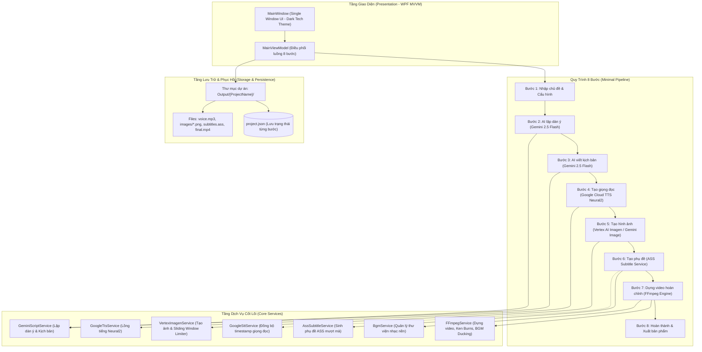
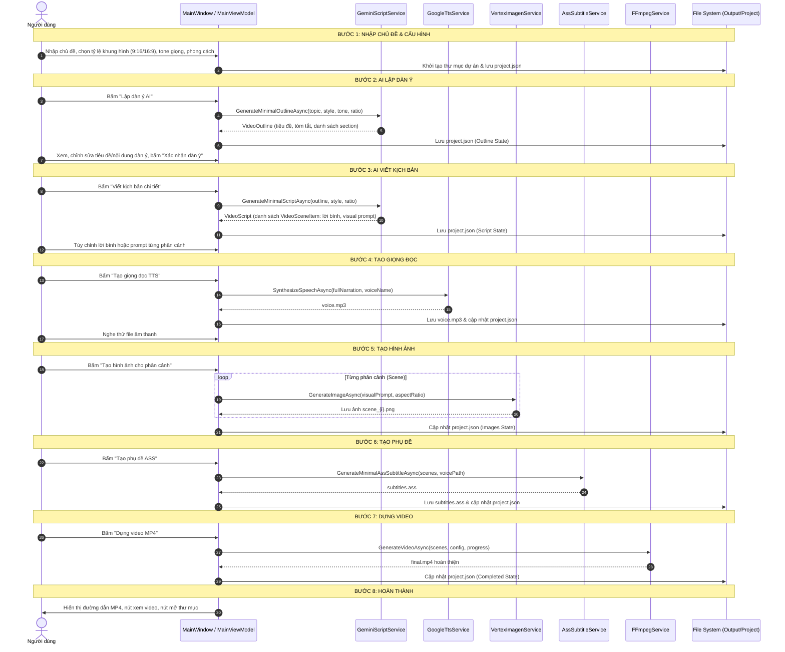

# KIẾN TRÚC HỆ THỐNG - VIDEOAUTOWPF MINIMAL
**Dự án:** VideoAutoWpf Minimal  
**Kiến trúc:** Single-Workflow Desktop Video Production Engine  
**Phiên bản:** Minimal 1.0 (.NET 10 WPF)  
**Tài liệu:** `docs/ARCHITECTURE.md`

---

## 1. Triết Lý Thiết Kế (Core Philosophy)

1. **Một Luồng Sản Xuất Duy Nhất (Single Sequential Workflow):** Toàn bộ quy trình sản xuất video gói gọn trong 8 bước tuần tự, không phân nhánh, không popup chồng chéo.
2. **Giao Diện Đơn Màn Hình (Single-Window Dark Tech UI):** Mọi thao tác nằm trong cửa sổ chính `MainWindow.xaml`. Loại bỏ hoàn toàn lỗi đóng app đột ngột do WPF `ShutdownMode.OnLastWindowClose`.
3. **Bảo Toàn Trạng Thái Từng Bước (Per-Step State Persistence):** Sau mỗi bước, trạng thái được tự động lưu vào `Output/{ProjectName}/project.json`. Khi một bước gặp sự cố (quota API, mất mạng), người dùng có thể thử lại ngay mà không phải tạo lại dữ liệu các bước trước.
4. **An Toàn Tuyệt Đối Về Nguồn Điện (Zero Power Commands):** Tuyệt đối loại bỏ `shutdown.exe`, `Stop-Computer`, `Restart-Computer`, Windows Task Scheduler tự động tắt máy. Ứng dụng chỉ hoạt động khi người dùng chủ động yêu cầu.
5. **Không Tự Động Hóa Ngầm (No Background Automation):** Không SQLite job scheduler, không bot Telegram duyệt bài, không tự động đăng lên mạng xã hội.

---

## 2. Sơ Đồ Kiến Trúc Tổng Thể (System Architecture)



---

## 3. Luồng Hoạt Động Chi Tiết 8 Bước (Pipeline Flow)



---

## 4. Cơ Chế Lưu Trữ & Phục Hồi Sự Cố (Failure Recovery & State Persistence)

Mỗi dự án video được đóng gói trong một thư mục độc lập:
```
Output/
  └── {Ten_Du_An}_{yyyyMMdd_HHmmss}/
      ├── project.json            # Trạng thái tổng thể & metadata các bước
      ├── voice.mp3               # File âm thanh giọng đọc TTS
      ├── subtitles.ass           # Phụ đề đã căn chỉnh thời lượng
      ├── final.mp4               # Video xuất bản phẩm hoàn thiện
      ├── Images/                 # Chứa các ảnh minh họa đã sinh
      │   ├── scene_001.png
      │   └── scene_002.png
      └── logs/                   # Ghi log tiến trình thực thi
```

Khi một bước gặp lỗi (ví dụ: Google TTS hết quota hoặc mất mạng):
1. Bước hiện tại đánh dấu `Failed` và hiển thị thông báo lỗi chi tiết trên banner.
2. Dữ liệu các bước trước (`Outline`, `Script`, `Images`) được bảo toàn 100% trong `project.json`.
3. Người dùng khắc phục sự cố (kiểm tra mạng, đổi giọng) và bấm thử lại ngay tại bước đó mà không cần làm lại từ đầu.
