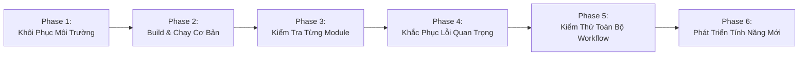

# KẾ HOẠCH KHỞI ĐỘNG LẠI VÀ PHÁT TRIỂN TIẾP (RESTART ROADMAP)
**Dự án:** VideoAutoWpf  
**Vai trò:** Senior Software Architect & .NET Technical Lead  
**Tài liệu:** `docs/ROADMAP.md`

---

## Lộ Trình 6 Giai Đoạn Tiếp Quản & Phát Triển

---

### Phase 1: Khôi Phục Môi Trường (Environment Restoration)
- **Mục tiêu:** Đảm bảo toàn bộ công cụ nền tảng, SDK, biến môi trường và tệp khóa xác thực được thiết lập đúng vị trí.
- **Công việc cần làm:**
  1. Kiểm tra phiên bản .NET SDK (`dotnet --version`, đảm bảo có .NET 10.0+).
  2. Bổ sung tệp `google_credentials.json` hợp lệ vào thư mục gốc dự án.
  3. Cấu hình biến môi trường `GEMINI_API_KEY` của Google AI Studio.
  4. Đưa thư mục `c:\TOOL\VideoAutoWpf` vào danh sách ngoại trừ (Exclusion) của Windows Defender để tránh bị Smart App Control chặn file DLL/EXE.
  5. Xóa bộ nhớ cache lỗi thời của Visual Studio (`ComponentModelCache` và `.vs`).
- **File / Module liên quan:** `google_credentials.json`, `Assets/*`, `VideoAutoWpf.csproj`.
- **Điều kiện hoàn thành (DoD):** Lệnh `dotnet --version` hiển thị SDK hợp lệ; thư mục `Assets/Bgm` có 5 file nhạc; `google_credentials.json` tồn tại.
- **Rủi ro:** Google Cloud Service Account bị hết hạn hoặc chưa kích hoạt đủ các API (TTS, STT, Vertex AI, Drive).

---

### Phase 2: Build và Chạy Thành Công (Build & Baseline Run)
- **Mục tiêu:** Dự án biên dịch sạch sẽ không có lỗi và khởi chạy giao diện đồ họa thành công trên máy tính.
- **Công việc cần làm:**
  1. Chạy lệnh biên dịch: `dotnet build VideoAutoWpf.csproj -c Debug`.
  2. Khởi chạy ứng dụng qua script: `.\Chay_App.bat`.
  3. Kiểm tra thanh trạng thái đầu trang: FFmpeg phải báo màu xanh ("Đã tìm thấy FFmpeg"), Google Cloud phải báo màu xanh ("Đã nạp credentials").
  4. Thử tính năng kéo thả (Drag & Drop) tệp vào MainWindow.
- **File / Module liên quan:** `App.xaml.cs`, `MainWindow.xaml`, `ViewModels/MainViewModel.cs`.
- **Điều kiện hoàn thành (DoD):** Cửa sổ MainWindow mở lên bình thường, các nút bấm phản hồi tốt, không có lỗi ném ra file `crash_log.txt`.
- **Rủi ro:** Tiến trình `VideoAutoWpf` trước đó bị treo giữ Mutex khiến ứng dụng tự đóng khi mở.

---

### Phase 3: Kiểm Tra Từng Module Độc Lập (Module-by-Module Verification)
- **Mục tiêu:** Xác minh từng dịch vụ con hoạt động chính xác với API thực tế trước khi ghép nối vào luồng tự động.
- **Công việc cần làm:**
  1. **Module Gemini:** Mở `ScriptGeneratorWindow`, nhập chủ đề "Lịch sử cà phê" và kiểm tra xem Gemini có trả về danh sách phân cảnh hay không.
  2. **Module TTS:** Bấm nút nghe thử giọng đọc `vi-VN-Neural2-D` trong giao diện chính.
  3. **Module STT & Imagen:** Chạy thử nghiệm tạo 1 phân cảnh đơn để kiểm tra tệp phụ đề `.ass` và ảnh sinh ra từ Imagen 3.
  4. **Module FFmpeg:** Dựng thử 1 video ngắn 10 giây xem hiệu ứng Ken Burns và burn phụ đề có mượt mà hay không.
  5. **Module Telegram Bot:** Nhập Bot Token và Chat ID, gửi tin nhắn kiểm tra kết nối từ `AutomationDashboardWindow`.
- **File / Module liên quan:** `Services/GeminiScriptService.cs`, `Services/GoogleTtsService.cs`, `Services/VertexImagenService.cs`, `Services/FFmpegService.cs`, `Services/Automation/TelegramApprovalService.cs`.
- **Điều kiện hoàn thành (DoD):** Cả 5 dịch vụ đều hoàn thành tác vụ thử nghiệm thành công.
- **Rủi ro:** Hết quota miễn phí của Vertex AI hoặc mạng chặn kết nối tới Telegram API.

---

### Phase 4: Khắc Phục Các Lỗi Quan Trọng & Tối Ưu Code (Bug Fixing & Hardening)
- **Mục tiêu:** Làm sạch các cảnh báo mã nguồn, nâng cao tính ổn định và bảo mật.
- **Công việc cần làm:**
  1. Khắc phục cảnh báo `CS0618` trong `GoogleDriveService.cs` bằng cách chuyển từ `GoogleCredential.FromStream` sang `CredentialFactory`.
  2. Xử lý triệt để các cảnh báo Nullable reference `CS8602` trong `YouTubeAnalyticsService.cs` và `SeriesCreatorViewModel.cs`.
  3. Cấu hình cơ chế xoay vòng khóa API (API Key rotation) cho Gemini nếu một key bị chạm trần Rate Limit.
  4. Hoàn thiện luồng Refresh Token cho TikTok Content Posting API.
- **File / Module liên quan:** `Services/GoogleDriveService.cs`, `Services/YouTubeAnalyticsService.cs`, `Services/Automation/TikTokPublishService.cs`.
- **Điều kiện hoàn thành (DoD):** Lệnh build không còn cảnh báo nghiêm trọng, ứng dụng xử lý ngoại lệ mạng êm ái mà không bị gián đoạn.
- **Rủi ro:** API bên thứ ba (TikTok/YouTube) thay đổi quy chuẩn request.

---

### Phase 5: Kiểm Thử Toàn Bộ Workflow Tự Động (End-to-End Workflow Testing)
- **Mục tiêu:** Chạy thử nghiệm trọn vẹn kịch bản tự động hóa từ A đến Z trên máy trạm mô phỏng chế độ Unattended Mini PC.
- **Công việc cần làm:**
  1. Đẩy 2 Job mẫu vào hàng đợi SQLite ở trạng thái `Pending`.
  2. Kích hoạt `PersistentJobScheduler`.
  3. Hệ thống render video -> Tự kiểm định chất lượng qua `QualityCheckService` -> Gửi thumbnail lên Telegram.
  4. Thao tác trên điện thoại: Bấm `[DUYỆT ĐĂNG]` cho Job 1 và `[TỪ CHỐI]` cho Job 2.
  5. Kiểm tra máy trạng thái xuất bản (PublishingStateMachine) xử lý đúng video đã duyệt sang chế độ DryRun.
  6. Kiểm tra `ShutdownCoordinator`: Chờ hệ thống đánh giá 12 quy tắc an toàn và gửi cảnh báo đếm ngược 60 giây tắt máy về Telegram.
- **File / Module liên quan:** Toàn bộ thư mục `Services/Automation/*`.
- **Điều kiện hoàn thành (DoD):** Toàn bộ quy trình diễn ra trơn tru không cần bàn tay can thiệp trên máy tính.
- **Rủi ro:** Người dùng quên bấm hủy tắt máy khiến máy tính thử nghiệm bị tắt thật.

---

### Phase 6: Tiếp Tục Phát Triển Tính Năng Mới (Future Enhancements)
- **Mục tiêu:** Mở rộng năng lực sản xuất nội dung quy mô lớn.
- **Các tính năng đề xuất:**
  1. **Tăng tốc phần cứng FFmpeg (Hardware Acceleration):** Tích hợp codec `h264_nvenc` (Card NVIDIA) hoặc `h264_amf` (Card AMD Radeon trên chip Ryzen 5600G) để tăng tốc độ render video lên gấp 3 - 5 lần so với CPU `libx264`.
  2. **Quản lý đa kênh (Multi-Channel Profile):** Cho phép cấu hình nhiều kênh YouTube/TikTok khác nhau, tự động phân phối video luân phiên theo chủ đề.
  3. **Bảng điều khiển Web từ xa (Remote Web Dashboard):** Xây dựng giao diện web nhẹ để theo dõi tiến độ hàng đợi từ xa qua trình duyệt mà không cần mở Remote Desktop (RDP).
  4. **Triển khai Module TFT Highlight (Nếu có nhu cầu):** Xây dựng từ đầu module sử dụng OpenCV / FFmpeg phân tích thanh máu, round đấu và thời điểm giao tranh trong game Đấu Trường Chân Lý để tự động cắt Shorts.
